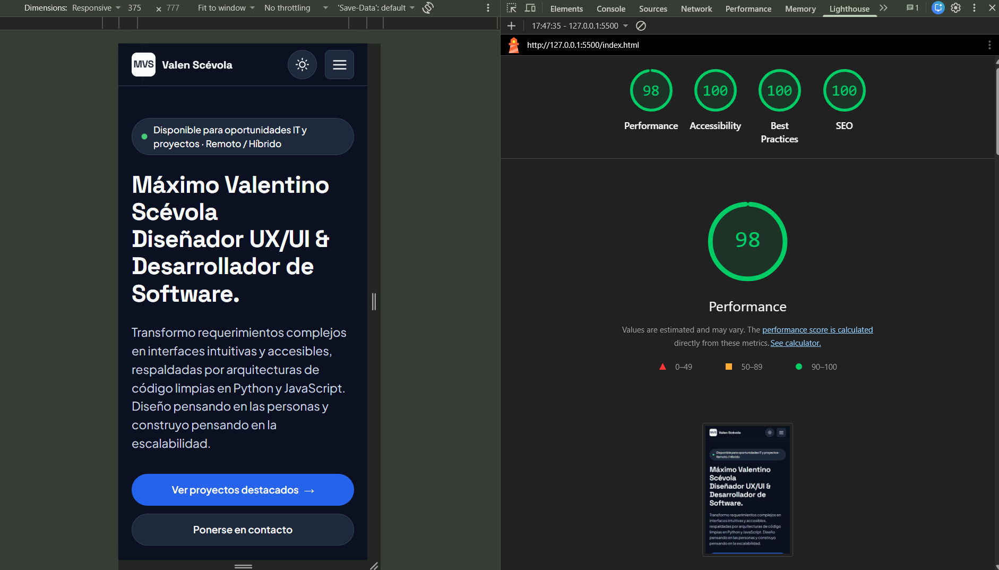

# Portfolio Personal — Máximo Valentino Scévola


> **Trabajo Práctico Final Integrador — Cátedra de Diseño UX/UI (2026)**  
> **Docente Titular:** Mg. Ernesto Ledesma  
> **Carrera:** Licenciatura en Sistemas de Información  
> **Institución:** Facultad de Ciencia y Tecnología — Universidad Autónoma de Entre Ríos (UADER - FCyT)  
> **Alumno:** Máximo Valentino Scévola (*Valen Scévola*)

---

## Descripción Ejecutiva

Portfolio web personal de una sola página (*One-Page*) diseñado y desarrollado desde cero para presentar mi perfil híbrido como **Diseñador UX/UI & Desarrollador de Software** (con foco en arquitecturas Backend en Python y FastAPI).

El proyecto traduce requerimientos de negocio y necesidades de reclutadores IT en una experiencia de lectura clara, accesible y rápida, articulando **9 secciones semánticas obligatorias**, un **Caso de Estudio profundo interactivo en modal (`SmartTicket`)** y una página de error personalizada (`404.html`). Cumpliendo estrictamente con las restricciones de la cátedra, fue construido **100% con código nativo puro (HTML5, CSS3 y JavaScript Vanilla)**, prescindiendo por completo de frameworks como React, Vue o Next.js.

---

## 1. Enlaces de Entrega

- **URL Pública Desplegada (Netlify):** https://maximo-scevola-uxui.netlify.app
- **Archivo de Diseño y Prototipo en Figma:** https://www.figma.com/design/GG6bmUU5Uc5m8SvYfVpAPE/TP-Final-UX-UI---M%C3%A1ximo-Sc%C3%A9vola?node-id=0-1&t=slXdOa7MZyRLsCc6-1
- **Repositorio Oficial en GitHub:** https://github.com/scevolamax/portafolio-UXUI.git

---

## 2. Concepto Visual y Sistema de Diseño ("Horología & Editorial Técnica")

La identidad visual del portfolio nace de la intersección entre la ingeniería de software y mi afición por la **relojería mecánica clásica**, sintetizada en **3 palabras clave**:

1. **Precisión:** Grillas modulares estrictas en múltiplos de `8px`, bordes estructurales finos de `1px` y jerarquía visual matemática donde cada bloque cumple una función clara.
2. **Claridad:** Ausencia de ruido decorativo, alto contraste tipográfico y comunicación directa de métricas e impacto técnico desde el primer vistazo.
3. **Confiabilidad:** Componentes predecibles con estados interactivos auditados (`Default`, `Hover`, `Focus-visible`, `Active`) y soporte nativo para preferencias del usuario (tema de color y reducción de movimiento).

### Paleta Dual Accesible (WCAG 2.2 Nivel AA / AAA)

El sistema evita deliberadamente el blanco y negro puros extremos (`#0a0a0a` prohibido) para disminuir la fatiga visual, implementando una paleta dual controlada por Custom Properties:

| Rol del Token | Variable CSS | Modo Claro ("Papel Técnico") | Modo Oscuro ("Azul Pizarra Horológico") | Ratio de Contraste Verificado |
| :--- | :--- | :---: | :---: | :--- |
| **Fondo Principal** | `--bg-primary` | `#F6F5F2` | `#0B1120` | Base de superficie |
| **Superficie de Tarjetas / Modal** | `--bg-surface` | `#FFFFFF` | `#1E293B` | Separación lumínica + borde `1px` |
| **Superficie Secundaria / Tags** | `--bg-subtle` | `#EAE8E1` | `#0F172A` | Contenedor sutil de apoyo |
| **Texto Primario (Títulos H1–H3)** | `--text-primary` | `#0F172A` | `#F8FAFC` | **16.8:1** (Claro) / **17.4:1** (Oscuro) — **AAA** |
| **Texto Secundario (Cuerpo / Fechas)** | `--text-secondary` | `#475569` | `#CBD5E1` | **6.85:1** (Claro) / **12.1:1** (Oscuro) — **AA/AAA** |
| **Acento Primario (Aguja Cobalto)** | `--accent-primary` | `#1E40AF` | `#2563EB` | **8.36:1** (Claro) / **5.17:1** (Oscuro) con `#FFFFFF` |
| **Enlaces y Overlines** | `--accent-link` | `#1E40AF` | `#60A5FA` | **8.36:1** (Claro) / **7.50:1** (Oscuro) — **AAA** |
| **Badge de Impacto (Fondo / Texto)** | `--badge-bg` / `--badge-text` | `#ECFDF5` / `#065F46` | `#064E3B` / `#D1FAE5` | **7.12:1** (Claro) / **8.95:1** (Oscuro) — **AAA** |
| **Anillo de Foco (`:focus-visible`)** | `--focus-ring` | `#2563EB` | `#60A5FA` | **4.80:1+** contra ambas superficies |

### Sistema Tipográfico

- **Títulos y Métricas (`--font-heading`):** **Space Grotesk** (`600 SemiBold`, `700 Bold`). Aporta carácter geométrico y técnico en el `<h1>` (`56px` en Desktop / `36px` en Mobile), encabezados de sección `<h2>` (`36px`) y cifras de impacto (`40px`).
- **Cuerpo de Texto e Interfaz (`--font-body`):** **Plus Jakarta Sans** (`400 Regular`, `500 Medium`, `600 SemiBold`, `700 Bold`). Garantiza máxima legibilidad en párrafos extensos, etiquetas de formulario, *overlines* y chips de tecnologías (`13px`–`18px`).

---

## 3. Stack Tecnológico y Arquitectura

- **HTML5 Semántico (`index.html` y `404.html`):**
  - Uso estricto de *landmarks* (`<header>`, `<nav>`, `<main id="main-content">`, `<section>`, `<article>`, `<ol class="timeline">`, `<footer>`).
  - Árbol de encabezados secuencial sin saltos (`<h1>` único en `#hero`, `<h2>` para secciones y `<h3>` para cada tarjeta o hito).
  - Metadatos completos de SEO, Open Graph (`og:title`, `og:description`, `og:image="assets/og-preview.webp"`, `og:locale="es_AR"`) y favicon vectorial (`assets/favicon.svg`).
- **CSS3 Nativo y Arquitectura Mobile-First (`styles.css`):**
  - Sistema de Design Tokens centralizado en `:root` con escala de espaciado en múltiplos de `8px` (`--space-1` a `--space-12`).
  - Maquetación con **CSS Grid** y **Flexbox** estructurada en **3 Breakpoints obligatorios**:
    1. **Base Mobile (`375px`):** Grilla de 4 columnas con margen lateral de `20px`, botones apilados al 100%, métricas en `2x2` y menú hamburguesa desplegable.
    2. **Tablet (`@media (min-width: 768px)`):** Margen lateral de `32px`, botones del Hero en fila horizontal y tarjetas de filosofía en 3 columnas.
    3. **Desktop (`@media (min-width: 1280px)`):** Contenedor máximo de `1120px` (12 columnas con `80px` de margen y `24px` de *gutter*), métricas en 4 columnas, *skills* en 3 columnas, proyectos tipográficos en 2 columnas, *timeline* asimétrico (`240px 1fr`), sección *Sobre mí* (`7fr 4fr`) y *Contacto* (`5fr 6fr`).
- **JavaScript Vanilla ES6+ (`main.js`):**
  - **Toggle de Tema Claro / Oscuro (`#theme-toggle`):** Hidratación sin parpadeo (*anti-FOUC*) en `<head>`, sincronización con `prefers-color-scheme`, alternancia manual mediante `data-theme="dark" | "light"` en `<html>`, actualización de `aria-pressed` y persistencia en `localStorage`.
  - **Modal Nativo `<dialog id="case-study-modal">`:** Apertura mediante `modal.showModal()` desde `#open-case-study` o la tarjeta destacada de *SmartTicket*, bloqueo de scroll del `<body>`, cierre con `#close-case-study`, tecla `Escape` o clic fuera de `.modal-container` (`::backdrop`), y restitución automática del foco al botón disparador.
  - **Menú Móvil Accesible (`.mobile-menu-toggle` y `#mobile-menu`):** Alternancia de `aria-expanded="true" | "false"`, `aria-label` dinámico, atributo `hidden` y cierre automático al navegar, presionar `Escape` o superar los `768px`.
  - **ScrollSpy con `IntersectionObserver`:** Actualización dinámica de `aria-current="page"` en los enlaces `.nav-link` según la sección activa en el viewport.
  - **Microinteracción de Portapapeles y Validación de Formulario:** Copia rápida de correo con `navigator.clipboard.writeText()` + anuncio `aria-live="polite"`, y validación accesible de campos requeridos con `aria-invalid`, `aria-describedby` e integración nativa con **Netlify Forms** (`data-netlify="true"`).
- **Infraestructura y Seguridad (`netlify.toml` y `robots.txt`):**
  - Cabeceras HTTP de seguridad (`X-Frame-Options = "DENY"`, `X-Content-Type-Options = "nosniff"`, `Referrer-Policy = "strict-origin-when-cross-origin"`, `Permissions-Policy`).
  - Caché inmutable (`max-age=31536000`) para `/assets/*` y regla de redirección `/* -> /404.html` con estado HTTP `404`.

---

## 4. Auditoría de Accesibilidad y Performance (Lighthouse Mobile)

El sitio fue auditado en **Google Chrome DevTools Lighthouse** simulando un dispositivo móvil (`375px` de ancho, *throttling* estándar), superando ampliamente el umbral de `>= 90` exigido por la cátedra en las 4 métricas:

| Categoría Auditada | Puntaje Real Obtenido | Umbral de Cátedra | Estado |
| :--- | :---: | :---: | :---: |
| **Performance** | **98 / 100** | >= 90 | Superado |
| **Accessibility** | **100 / 100** | >= 90 | Puntaje Perfecto |
| **Best Practices** | **100 / 100** | >= 90 | Puntaje Perfecto |
| **SEO** | **100 / 100** | >= 90 | Puntaje Perfecto |



### Checklist de Cumplimiento WCAG 2.2 Nivel AA

- **Contraste Verificado (1.4.3 / 1.4.6 / 1.4.11):** Todos los textos normales superan el mínimo de `4.5:1` (alcanzando niveles AAA de `16.8:1` y `17.4:1`), y los bordes de formulario (`--border-input`) superan el ratio `3:1` en ambos temas.
- **Navegación 100% por Teclado y Orden de Foco (2.1.1 / 2.4.3 / 2.4.7):** Recorrido completo mediante `Tab`, `Shift + Tab`, `Enter` y `Escape`, con anillos `:focus-visible` de `2px solid var(--focus-ring)` y halo exterior de `3px`.
- **Enlace de Salto (`skip-link` — 2.4.1):** `<a href="#main-content" class="skip-link">Saltar al contenido principal</a>` ubicado como primer hijo del `<body>`, permettant esquivar la barra de navegación fija con una sola pulsación de `Tab`.
- **Atributos ARIA y Estados Semánticos (4.1.2):** Uso riguroso de `aria-expanded`, `aria-controls`, `aria-haspopup="dialog"`, `aria-labelledby`, `aria-pressed`, `aria-current="page"`, `aria-invalid`, `aria-describedby` y `aria-hidden="true"` en todos los íconos SVG decorativos.
- **Tamaño de Áreas Táctiles (2.5.8 Target Size):** Todos los botones principales tienen `48px` de altura y ningún control interactivo o enlace baja de `44x44px` en mobile.
- **Respeto por Reducción de Movimiento (2.3.3):** Bloque `@media (prefers-reduced-motion: reduce)` que desactiva `scroll-behavior: smooth`, pulsos de estado y transiciones para usuarios con trastornos vestibulares.
- **Prevención de CLS (Cumulative Layout Shift = 0):** Imágenes en formato `.webp` con atributos `width="400"`, `height="480"`, `loading="lazy"` y `decoding="async"` explícitos.

---

## 5. Guía Paso a Paso del Despliegue Continuo (CI/CD en Netlify)

El proyecto cuenta con un flujo de **Integración y Despliegue Continuo (CI/CD)** conectando GitHub con Netlify para que cada actualización en la rama principal se publique automáticamente en producción con certificado SSL/HTTPS:

1. **Preparación del Repositorio en GitHub:**
   - Se inicializó el repositorio Git local, verificando que `index.html`, `404.html`, `styles.css`, `main.js`, `netlify.toml`, `robots.txt` y la carpeta `assets/` estén versionados en la rama `main`.
   - Se subieron los cambios al repositorio remoto mediante `git push -u origin main`.
2. **Vinculación con Netlify:**
   - Desde el panel de Netlify (*Add new site → Import an existing project*), se seleccionó **Deploy with GitHub** y se autorizó el acceso al repositorio `portafolio-UXUI`.
3. **Configuración de Build y Publicación:**
   - Netlify detectó automáticamente el archivo `netlify.toml` en la raíz del proyecto:
     - **Branch to deploy:** `main`
     - **Build command:** *(vacío, por tratarse de un sitio estático nativo puro)*
     - **Publish directory:** `.` *(raíz del repositorio)*
4. **Activación de Netlify Forms y Reglas de Redirección:**
   - Durante el *post-processing* del deploy, Netlify detectó el atributo `data-netlify="true"` y el campo oculto `form-name="contact"` en `index.html`, habilitando el backend serverless para recibir envíos del formulario sin código de servidor adicional.
   - Asimismo, aplicó los *Security Headers* y la redirección automática a `/404.html` definidos en `netlify.toml`.
5. **Despliegue Continuo (CI/CD Activo):**
   - A partir de esta configuración, cualquier `git commit` y `git push origin main` dispara un nuevo *build* en Netlify y actualiza el sitio en producción en menos de 15 segundos bajo protocolo seguro HTTPS.

---

## 6. Estructura del Proyecto

```text
portafolio-UXUI/
├── index.html                              # Estructura semántica de las 9 secciones + modal <dialog>
├── 404.html                                # Página de error 404 personalizada y accesible
├── styles.css                              # Design Tokens (:root), modo oscuro, grillas y estados WCAG
├── main.js                                 # JS Vanilla (toggle de tema, menú mobile, modal, scrollspy, form)
├── netlify.toml                            # Configuración de CI/CD, Security Headers y redirección 404
├── robots.txt                              # Directivas de rastreo para motores de búsqueda
├── README.md                               # Documentación oficial del repositorio
└── assets/
    ├── favicon.svg                         # Ícono vectorial MVS (#1E40AF y #FFFFFF)
    ├── og-preview.webp                     # Imagen Open Graph (1200x630px) para redes sociales
    ├── profile-valen-scevola.webp          # Retrato optimizado en formato WebP (400x480px)
    ├── retrato.webp                        # Copia de respaldo del retrato original
    ├── lighthouse-mobile.png               # Captura oficial de la auditoría Lighthouse Mobile (98/100/100/100)
    ├── CV-Maximo-Valentino-Scevola.pdf     # Currículum Vitae descargable en PDF
    └── generate-og.ps1                     # Script PowerShell utilizado para generar og-preview.webp
```

---

## 7. Declaración de Uso de Inteligencia Artificial y Recursos (Política de la Cátedra)

En cumplimiento con los criterios de transparencia e integridad académica establecidos por la cátedra de Diseño UX/UI (UADER - FCyT):

- **Uso de Inteligencia Artificial como Copiloto:** Se utilizó **Google Gemini** y el asistente integrado de **Antigravity IDE** como herramientas de apoyo para iterar borradores de *copywriting* UX, estructurar el *boilerplate* inicial de HTML5 semántico / CSS3 nativo y verificar reglas técnicas de accesibilidad WCAG 2.2 AA.
- **Autoría, Validación y Trabajo Manual del Alumno:** La definición estratégica de la proto-persona y el benchmark, la dirección estética *"Horología & Editorial Técnica"*, la construcción íntegra del Sistema de Diseño y prototipos en Figma, la selección y documentación de los proyectos reales (*SmartTicket*, *Rediseño Web UX/UI*, *Motor de Grafos Star Wars*), la integración de fotografía propia y las pruebas de contraste, teclado y rendimiento en el navegador fueron realizadas, revisadas, validadas y ajustadas manualmente por el alumno **Máximo Valentino Scévola**.
- **Recursos Gráficos y Tipográficos:**
  - Tipografías *Space Grotesk* y *Plus Jakarta Sans* provistas bajo licencia abierta (SIL Open Font License) a través de Google Fonts.
  - Íconos SVG de interfaz (GitHub, ubicación, menú, sol/luna) trazados en código vectorial limpio con `aria-hidden="true"`.
  - Retrato fotográfico personal tomado y optimizado por el autor en formato `.webp`.
